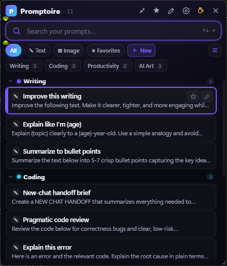
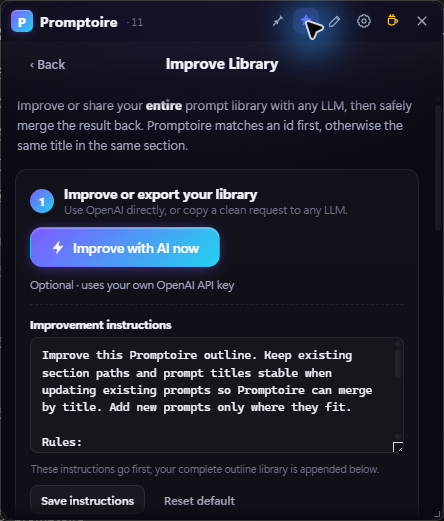

<div align="center">

# Promptoire

**A fast, beautiful, local-first home for your text *and* image prompts — with one-click AI bulk-improve.**

*Hit a hotkey → find a prompt → click to copy → keep moving. Then hand any part of your library to an LLM and safely bring the improved version back.*

[](https://github.com/diddlysquatt/Promptoire/actions/workflows/ci.yml)   

</div>

<p align="center">
  
  
</p>

<p align="center">
  <a href="https://github.com/diddlysquatt/Promptoire/releases/latest"><strong>Download for Windows</strong></a>
  · <a href="https://diddlysquatt.github.io/Promptoire/">Website</a>
  · <a href="#how-it-works">How it works</a>
  · <a href="docs/PRIVACY.md">Privacy</a>
  · <a href="CONTRIBUTING.md">Contributing</a>
</p>

---

## Download

Promptoire is a portable Windows 10/11 app. It has no installer, account, cloud service, or bundled browser.

1. Download `Promptoire-2.3.0-windows-x64.zip` from the [latest release](https://github.com/diddlysquatt/Promptoire/releases/latest).
2. Extract the folder somewhere permanent.
3. Run `Promptoire.exe`.
4. Set your preferred global hotkey under **Settings → Activation**.

Promptoire uses Microsoft Edge WebView2, which is already present on Windows 11 and most Windows 10 systems. The release also includes a SHA-256 checksum. Because the executable is not code-signed, Windows SmartScreen may initially show **Unknown publisher**; verify the checksum and use **More info → Run anyway** if you trust the download. See the [Windows trust and signing guide](docs/SMARTSCREEN.md) for the reason and the project's signing path.

## How it works

1. **Summon it anywhere.** Press your configurable hotkey and Promptoire opens near the cursor.
2. **Find and copy fast.** Search, browse nested categories, or use favorites. Clicking a prompt copies it, and Promptoire can disappear immediately.
3. **Improve the whole system.** Export an outline to any LLM, ask it to rewrite or expand your prompts, then preview and safely merge the result back.

## Why Promptoire

Most prompt tools are cloud apps, browser extensions that disappear outside the browser, or generic clipboard managers that don't understand prompt libraries. Promptoire keeps a deliberately focused combination in one quiet Windows launcher:

- **🧠→📄→🧠 Bulk-improve loop.** Export your *entire* library as a simple outline, paste it into ChatGPT / Claude / any LLM with a built-in "improve & expand these" instruction, then re-import. Outline and JSON changes are shown in a **diff preview** before anything is written.
- **✎ + ▦ Text *and* image prompts, first-class.** Keep your LLM prompts next to your Midjourney / Stable Diffusion / Flux prompts. Image prompts carry their own fields — negative prompt, model, parameters (`--ar`, `--stylize`, steps, CFG…).
- **🔒 Local-first, free, open source.** Your prompts live in a plain `prompts.json` on your machine. No account, no cloud, no telemetry. Back up by copying a file.

Plus the basics done well: a global hotkey that pops the launcher at your cursor, fuzzy search with keyboard nav, a compact **+ New** action beside the filters, `{placeholder}` fill-in before copy, favorites, tags, nested categories, drag-to-reorder, three prompt-density modes, a resizable window, timestamped backups, a one-click local data folder, and a handful of themes.

## ✨ Highlights

| | |
|---|---|
| ⌨️ **Global hotkey** | Summon it anywhere (default `Ctrl+Alt+Space`), at your cursor. |
| 🌳 **The tree, right in the launcher** | Browse your whole library grouped by category — collapsible, color-coded, icons and counts — before you type a single letter. |
| 🏷️ **Category rail + tag search** | One-tap category filters with reliable click-drag/wheel scrolling; type `#tag` (or click any tag) to filter. |
| ⚡ **Copy & vanish** | Click a prompt → it's on your clipboard → window hides. Or pin it open. |
| ↕️ **Your preferred density** | Cycle Roomy, Compact, or Titles-only from the launcher; drag any window edge or corner to resize. |
| 🔣 **Placeholders** | `{topic}`, `{tone}`, `{code}` → quick fill-in form before copy. |
| 🗂️ **Real organization** | Subcategories, emoji icons, accent colors, drag prompts between categories, drag to reorder categories, filter the manage view. |
| 🪶 **Light & fast** | Renders through the system WebView, stays quiet at idle, and does not bundle a second browser. |
| 🎨 **Themeable** | Matrix, Cyber, Aurora, Ember, Sunset, Emerald, Mono, Paper (light). |
| 💾 **Safe** | Atomic saves + rolling timestamped backups. |

## Run from source

Requires **Python 3.9+** and the **WebView2 runtime** (preinstalled on Windows 11 and most Windows 10).

```bat
:: 1. one-time setup (creates a venv, installs deps, adds desktop shortcut)
setup.bat

:: 2. run it
Promptoire.bat
```

`setup.bat` also refreshes a `PROMPTOIRE` desktop shortcut that launches the local checkout.
`Check-PromptoireShortcut.ps1` verifies that shortcut, and `check-release.bat` runs it as part of the local release gate.

If the project folder itself still displays as `promptoire`, close Promptoire, Codex, terminals, and File Explorer windows inside the project, then run `Rename-PromptoireFolder.ps1`. It safely renames the folder to `PROMPTOIRE` and refreshes the desktop shortcut.

…or manually:

```bash
pip install -r requirements.txt
python -m promptoire_app
```

To launch at login, enable **Launch at startup** in Settings.

## Build a standalone `.exe`

```bat
build.bat            :: → dist\Promptoire\Promptoire.exe
```

(Uses PyInstaller via `Promptoire.spec`; one-dir build for fast, AV-friendly startup.)

## 🔁 The bulk-improve loop

1. Open **Improve library** (sparkle icon).
2. Edit the visible **Improvement instructions** if needed. **Copy instructions + library** puts those instructions first and your complete plain-text outline directly below. **Copy library only**, **Copy instructions only**, and **Save library outline** do exactly what their names say. JSON compatibility tools live under **More options**.
3. Paste into any LLM. It can return the plain outline format, or JSON if you use the compatibility tools.
4. Paste that back, click **Paste from clipboard**, or **Load from file** (`.json`, `.txt`, `.md`, or `.csv`). Manual paste and file/clipboard loads auto-preview so you can see incoming, new, updated, and unchanged counts before anything is written. **Clear** resets the import box when you want to start over.
5. **Merge**. **Update existing** matches a prompt id first, otherwise a unique normalized title in the exact section path; it never moves or deletes a local prompt. **Add new** adds only unmatched prompts and creates their missing path. Blank imported fields never erase nonblank local content, and repeated or ambiguous rows are shown and safely skipped. If the selected mode would do nothing, Promptoire disables the merge.

The outline instruction stays visible in that panel, with **Save instructions** and **Reset default** beside it. The older JSON instruction remains available under **More options** for compatibility.

For brand-new prompt batches without exporting your existing library, open **More options → Create prompts for a topic…**. Add a topic or workflow, then copy a ready instruction that asks an LLM for sections, subsections, and prompt rows you can paste straight back into Promptoire.

**Prefer one click?** **Improve with AI now** sits near the top of the panel. Add your OpenAI API key in the optional **OpenAI connection** section at the bottom of the same panel and choose a current GPT-5.6 family model. Promptoire sends the visible instructions plus outline library to OpenAI, puts the reply in the import box, and opens the same diff preview. The key is stored locally only, and the copy/paste loop always works without it.

<details>
<summary><strong>Data format and supported LLM import shapes</strong></summary>

<br>

Everything lives in `prompts.json` next to the app — human-readable and easy to edit by hand or with an LLM:

```jsonc
{
  "version": 3,
  "categories": [
    {
      "id": "cat_…", "name": "AI Art", "icon": "🎨", "color": "#f472b6",
      "prompts": [
        {
          "id": "prm_…", "type": "image",
          "title": "Cinematic portrait",
          "prompt": "cinematic portrait of {subject}, dramatic rim lighting, 85mm…",
          "tags": ["portrait"],
          "negative": "blurry, watermark", "model": "Midjourney v6", "params": "--ar 4:5 --stylize 250"
        }
      ],
      "subcategories": []
    }
  ]
}
```

For quick appends or no-JSON library passes, the import box also accepts a plain outline. **Copy library only** exports your current prompts in this same format:

```md
Coding
  Debugging
    Bug sweep: Review this code for edge cases, broken assumptions, and missing tests.

Path: AI Art > Characters > Portraits
Title: Cinematic portrait
Type: image
Prompt: A dramatic 85mm portrait of {subject}, rim lighting, shallow depth of field.
Negative prompt: blurry, watermark, extra fingers
Image model: Midjourney v6
Parameters: --ar 4:5 --stylize 250

Subsection: Environments
Dreamy landscape: A vast {place} at golden hour, painterly atmosphere, cinematic light.

- Workflows
  - Research
    - Literature
      - Source map: Map the strongest sources for {topic}.

Prompts:
  - Title: Tight rewrite
    Prompt: Rewrite {text} clearly while preserving voice.
    Tags: editing, clarity
```

Headings, `Path: Section > Subsection > Nested subsection`, `Section:` / `Subsection:` labels, indented plain text, nested bullet trees, YAML-style `- Title:` blocks, and Markdown/CSV tables with `Title` + `Prompt` columns become categories and subcategories. Deeper Markdown headings such as `### Prompt title` can also become prompt titles when followed by prompt body text. JSON compatibility imports accept `categories`/`sections`, `subcategories`/`subsections`, and `prompts`/`items`/`entries` aliases; flat JSON prompt rows can include `path`, `section`, and `subsection` fields; plain JSON string prompts become text prompts with derived titles. JSON image fields can use aliases like `negative_prompt`, `image_model`, `parameters`, and `cfg_scale`. For deeper labels, use `Sub-subsection:` or `Nested subsection:`. Repeated unindented `Subsection:` labels stay under the latest `Section:`. Prompt rows become prompts, and numbered blocks like `Prompt 1:` also work for multi-line prompts. Image labels like `Negative prompt:`, `Image model:`, `Parameters:`, and `CFG scale:` map to the normal image fields. If an LLM wraps the outline in a Markdown code fence, Promptoire reads the fenced outline instead of importing the fence text. Merging an outline adds to matching sections and does not replace the existing library; if a prompt title already exists in that section, Promptoire updates it instead of creating a duplicate.

For public forks and packaged releases, `prompts.json` is treated as local user data and ignored by git. Fresh installs seed a small starter library automatically; `prompts.example.json` is included only as a clean reference file.

</details>

## ⌨️ Shortcuts

| Action | Key |
|---|---|
| Summon launcher (global) | `Ctrl+Alt+Space` *(configurable)* |
| Focus search | `Ctrl+F` or `Ctrl+K` |
| Edit library | `Ctrl+E` |
| Improve library | `Ctrl+I` |
| Settings | `Ctrl+,` |
| New prompt | `Ctrl+N` |
| Type filter (All / Text / Image / ★) | `Ctrl+1…4` or `Tab` |
| Navigate / copy | `↑ ↓` (`PgUp/PgDn`) / `Enter` |
| Filter by tag | type `#tag`, or click a tag chip |
| Back / hide | `Esc` |

## 🛠️ Architecture

- **Backend** (`promptoire_app/core`, `/platform`): Python. Data layer (v3 schema, migration, search, merge), settings, global hotkey, tray, clipboard.
- **Frontend** (`promptoire_app/web`): zero-build vanilla HTML/CSS/JS, rendered by the system WebView through [pywebview](https://pywebview.flowrl.com/). No framework, no bundler.

## Development and trust

- Run `check-release.bat` for the complete local release gate.
- Run `Check-GitHubPublish.ps1` immediately before changing the repository from private to public.
- Read [Contributing](CONTRIBUTING.md) before opening a pull request.
- See the [Changelog](CHANGELOG.md), [Privacy](docs/PRIVACY.md), and [Security](SECURITY.md) documents.
- Maintainers can use the detailed [GitHub release checklist](docs/GITHUB_RELEASE_CHECKLIST.md).

Promptoire has no telemetry. It stores prompts and settings locally and only sends prompt data elsewhere when you explicitly copy/export it or use the optional direct AI-improve action.

## ❤️ Support

Promptoire is free and open source. If it earns a spot in your workflow, you can use the quiet coffee link in the titlebar.

## 📄 License

MIT — use it, fork it, ship it.
